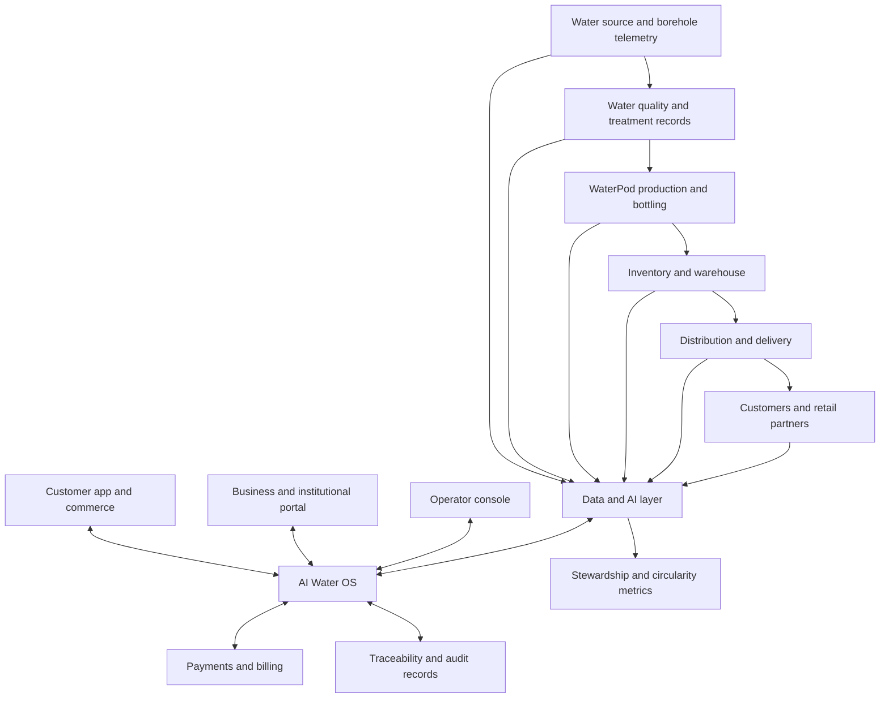

# Milimani Fresh AI

**Intelligent Water. Seamless Experience. Healthier Communities.**

Milimani Fresh AI is a concept for a customer-centric water intelligence platform that connects borehole sourcing, treatment, modular WaterPod production, quality records, inventory, delivery operations, payments, customer service, and packaging circularity in one operating system.

The experience is designed to take a water business **from source to smile**: customers can discover products, order and schedule deliveries, pay, track an order, and review batch-level traceability, while operators coordinate production, inventory, quality, fleet activity, and demand from a shared control surface.

> **Prototype data notice:** Every operational figure, chart, quality reading, customer record, production node, and impact metric displayed in the concept is illustrative demo data unless independently verified and explicitly identified otherwise. The interface is not evidence that a water source, batch, facility, delivery network, or impact claim is operating or certified in the real world.

---

## Contents

- [Vision](#vision)
- [Product principles](#product-principles)
- [Core capabilities](#core-capabilities)
- [Customer journey](#customer-journey)
- [Platform architecture](#platform-architecture)
- [AI operations command center](#ai-operations-command-center)
- [Water quality and traceability](#water-quality-and-traceability)
- [Commerce and customer experience](#commerce-and-customer-experience)
- [Business and institutional supply](#business-and-institutional-supply)
- [Circularity and water stewardship](#circularity-and-water-stewardship)
- [Transparency, safety, and governance](#transparency-safety-and-governance)
- [Illustrative network model](#illustrative-network-model)
- [Roadmap](#roadmap)
- [Development setup](#development-setup)
- [Contributing](#contributing)
- [License](#license)

## Vision

Make dependable water access easier to manage, buy, trace, and scale by connecting local production infrastructure with useful software and accountable operations.

Milimani Fresh AI explores a distributed model in which modular, digitally connected **WaterPods™** can act as production nodes within a broader water network. Instead of treating sourcing, production, fulfilment, customer service, and sustainability as separate systems, the platform connects them around one operational picture.

The long-term ambition is an adaptable African water network that can serve households, retailers, hospitality, workplaces, schools, healthcare facilities, and other institutions while supporting responsible water use and circular packaging.

## Product principles

- **Trust by design:** Make source, batch, treatment, testing, and delivery records discoverable.
- **Useful intelligence:** Turn operational data into explainable forecasts and recommendations, not opaque automation.
- **Human accountability:** Keep qualified people responsible for water safety, extraction decisions, quality release, and other high-impact actions.
- **Customer dignity:** Make discovery, ordering, payment, tracking, subscriptions, and support straightforward.
- **Distributed resilience:** Design for modular production nodes and neighbourhood-level fulfilment.
- **Measurable stewardship:** Track water-source health, energy use, packaging recovery, and community access with clearly defined methods.
- **Honest reporting:** Label simulations, illustrative values, estimates, and verified measurements separately.

## Core capabilities

### 1. AI Water OS

A unified operational workspace for:

- Orders and customer demand
- Production planning and output monitoring
- Inventory and reorder thresholds
- Water-quality records and batch status
- Deliveries, route planning, and fleet activity
- Customer accounts, subscriptions, and support
- Analytics, alerts, maintenance, and platform settings

### 2. WaterPod production intelligence

A modular production model designed to coordinate output, inventory needs, energy use, bottling yield, filtration maintenance, and quality checkpoints. Recommendations should be based on validated telemetry and remain reviewable by the responsible operator.

### 3. Intelligent fulfilment

A delivery workflow that connects order status, location, estimated arrival, route sequence, fulfilment hubs, and the relevant source or batch record.

### 4. Batch-level traceability

A customer-facing record intended to connect a bottle or case to its source, treatment process, quality evidence, production batch, and distribution path.

### 5. Customer and business commerce

Support for one-off orders, recurring subscriptions, scheduled delivery, pickup, bulk orders, corporate invoicing, and multi-location supply planning.

### 6. Circularity and stewardship

An information layer for packaging collection, reuse or recycling pathways, recycled content, source-health monitoring, energy efficiency, and community-access initiatives.

## Customer journey

The intended experience follows six connected moments:

1. **Discover** — View the catalogue, quality promise, local availability, offers, and subscriptions.
2. **Order** — Choose a size, quantity, delivery or pickup option, and one-time or recurring fulfilment.
3. **Pay securely** — Use the payment methods actually enabled for the deployment, such as M-Pesa, cards, or a supported wallet.
4. **Produce** — Coordinate production and stock against anticipated demand and confirmed orders.
5. **Track** — Follow order status, delivery ETA, and relevant source or batch information.
6. **Enjoy and verify** — Receive the order, provide feedback, and review its traceability record.

The product should be usable on mobile devices and accessible to customers with different levels of digital literacy and connectivity.

## Platform architecture

The following diagram describes the **conceptual architecture**, not a claim about a deployed implementation.

### Logical platform layers

| Layer | Responsibility |
|---|---|
| Water intelligence | Source condition, extraction monitoring, treatment records, and quality evidence |
| WaterPod production | Capacity, output plans, energy, bottling, yield, and maintenance signals |
| Market and commerce | Catalogue, pricing, orders, subscriptions, retailers, and business contracts |
| AI Water OS | Shared operational view, alerts, forecasts, recommendations, and workflow orchestration |
| Production intelligence | Demand planning, production schedules, and inventory coordination |
| Logistics intelligence | Fulfilment, route sequencing, delivery status, and fleet utilisation |
| Customer experience | Ordering, payments, tracking, support, rewards, and subscriptions |
| Data and AI cloud | Data integration, analytics, forecasting, and decision support |
| Fintech and payments | Payment-provider integration, billing, invoices, and transaction reconciliation |
| Trust and traceability | Batch records, quality evidence, event history, and auditability |
| Regeneration and stewardship | Source-health indicators, energy, packaging circularity, and access reporting |

Actual services, databases, infrastructure, APIs, and framework choices should be documented from the repository's implemented code rather than inferred from this product architecture.

## AI operations command center

The command center is intended to give operators one view of the water business, including:

- **Production:** Planned versus actual output by time period and node.
- **Demand:** Forecasts by product, location, and customer segment.
- **Inventory:** Stock levels, days of cover, and reorder recommendations.
- **Quality:** Batch records, test status, exceptions, and release gates.
- **Maintenance:** Equipment condition, service schedules, and maintenance alerts.
- **Logistics:** Active deliveries, route performance, estimated arrival, and fulfilment bottlenecks.
- **Customer experience:** Orders, service status, satisfaction feedback, refunds, and recurring needs.
- **Analytics:** Trends, costs, operational performance, and stewardship indicators.

Example recommendations shown in the demo—such as a predicted increase in demand, a suggested production quantity, route savings, or an upcoming filter replacement—are illustrative only. A production system should display the source data, time window, assumptions, confidence, and relevant constraints behind each recommendation.

## Water quality and traceability

A traceability record is envisioned to connect the following information for each batch:

- Source identifier and relevant source-health observations
- Treatment stages and operating records
- Sampling time, test method, laboratory or responsible tester, and results
- Batch identifier and production timestamp
- Packaging or bottling line
- Warehouse, distribution hub, route, and delivery events
- Corrective actions, holds, and release decision where relevant

### Safety note

Any pH, total dissolved solids (TDS), turbidity, microbiological result, or “quality assured” indicator in the demonstration interface is **sample data**, not a declaration that water is potable or compliant. Water safety must be established through appropriate sampling, validated testing, applicable Kenyan requirements, qualified oversight, and documented release procedures. A dashboard must not mark a batch safe merely because a sensor reading falls within a displayed range.

## Commerce and customer experience

The customer-facing experience is intended to include:

- Product catalogue for formats such as 330 ml, 500 ml, 1.5 L, 5 L, 10 L, and 20 L, where those SKUs are actually offered
- One-time, scheduled, subscription, pickup, and bulk ordering
- Secure checkout through supported payment providers
- Order history, delivery tracking, and ETA updates
- Subscription changes, pauses, and cancellations
- Rewards, customer support, and refund workflows
- QR-enabled batch traceability
- A conversational water assistant for order management and common questions

Payment options must reflect real integrations available in the deployed environment. Do not display a payment method as active until its integration and end-to-end flows have been tested.

## Business and institutional supply

A separate B2B interface can support customers such as hotels, restaurants, offices, schools, hospitals, events, retailers, and distributors.

Potential capabilities include:

- Contract and bulk ordering
- Recurring supply agreements
- Invoice and account management
- Delivery scheduling across multiple locations
- Consumption analytics and automated reorder suggestions
- Retailer and distributor workflows
- Service-level reporting and issue escalation

Institutional supply features should account for contract terms, approved delivery windows, stock allocation, account permissions, and auditable changes.

## Circularity and water stewardship

The platform's stewardship layer is intended to track operationally meaningful indicators across three areas.

**Water-source stewardship**

- Water levels and source condition
- Extraction volumes and permitted limits
- Recharge observations where measurable
- Source and treated-water quality records
- Pumping and treatment energy use

**Packaging circularity**

- Packaging placed on the market
- Collection points and recovery events
- Reuse, recycling, and verified recovery quantities
- Recycled content, with the calculation method stated

**Community access and operational resilience**

- Service coverage and availability
- Delivery reliability and affordability indicators
- Operational efficiency and energy performance
- Community initiatives and jobs, where supported by evidence

The proposed **Milimani Water Resilience Index** is an internal prototype concept, not a scientifically validated or externally certified index. Before using it to make public claims or allocate capital, publish its methodology, units, data sources, weights, uncertainty, validation process, and governance arrangements.

## Transparency, safety, and governance

A responsible implementation should include the following safeguards:

- Clearly distinguish **demo**, **simulated**, **estimated**, **sensor-reported**, **lab-verified**, and **audited** values.
- Keep an audit trail for important operational changes and decisions.
- Use role-based access controls for operators, delivery teams, customers, and institutional accounts.
- Protect personal information and payment-related data; use vetted providers for payment processing rather than storing raw card data in the application.
- Validate data quality, time stamps, units, sensor calibration, and device connectivity.
- Use human approval for high-impact recommendations involving water safety, source extraction, batch release, or critical maintenance.
- Provide alerting and fallback procedures when sensors, network connectivity, or external services fail.
- Define retention, access, incident response, and recovery policies before production deployment.
- Review environmental and social claims against documented evidence before publication.

The platform is intended to support qualified people and accountable operating procedures. It should not replace laboratory testing, regulatory compliance, engineering judgement, or responsible water-resource management.

## Illustrative network model

The concept explores a network of modular production nodes that can be deployed and managed as a coordinated system. The interface may show example labels such as **Live**, **Planned**, or **Roadmap** for nodes in locations including Milimani, Nairobi, Kiambu, and the Nakuru corridor.

These labels must be synchronised with real deployment records before public use. Do not represent a proposed location as operational, or imply a network has a particular capacity, coverage, or number of customers without verifiable evidence.

The intended scaling pattern is:

1. Validate one production node, operating procedures, and unit economics.
2. Instrument source, production, quality, inventory, and fulfilment workflows.
3. Establish reliable customer and business supply in a defined service area.
4. Standardise the deployment, maintenance, data, and governance playbook.
5. Replicate nodes where water-resource, regulatory, commercial, and community conditions support it.

## Roadmap

The following is a proposed product roadmap, not a statement of completed work.

- [ ] **Foundation:** Document the implemented stack, environments, data model, and deployment process.
- [ ] **Commerce MVP:** Product catalogue, checkout, order lifecycle, customer profiles, and support.
- [ ] **Operations MVP:** Production planning, inventory, quality records, and order fulfilment.
- [ ] **Traceability MVP:** Batch IDs and auditable source-to-delivery records.
- [ ] **B2B portal:** Contracts, invoices, scheduled orders, and multi-location management.
- [ ] **AI decision support:** Forecasts and recommendations with explainable inputs, confidence, and human review.
- [ ] **WaterPod integration:** Secure ingestion of validated equipment and source telemetry.
- [ ] **Stewardship reporting:** Publish calculation methods and evidence for water, energy, and packaging indicators.
- [ ] **Scale readiness:** Security review, operational resilience tests, compliance review, and documented incident response.

## Development setup

This README describes the product concept. The repository's actual framework and run commands were not included in the supplied brief, so the steps below should be completed against the implementation rather than guessed.

1. Clone the repository and enter its directory.
2. Install dependencies using the package manager indicated by the repository's lockfile.
3. Copy the example environment file, if present, and configure the required variables. Never commit secrets or production credentials.
4. Start the development command defined by the repository's package scripts or equivalent tooling.
5. Use synthetic records in local development and confirm that demo data is visibly labelled.

Before publishing this README, replace this section with the verified commands for this repository, the required runtime version, environment-variable names (without secret values), test and lint commands, and deployment instructions.

## Contributing

Contributions should improve clarity, usability, reliability, accessibility, safety, or operational transparency.

1. Open an issue describing the problem, user need, or proposed change.
2. Keep changes focused and document assumptions or changes to data definitions.
3. Add or update tests for relevant behaviour.
4. Never include real customer data, credentials, payment details, or sensitive infrastructure information in issues, commits, fixtures, or screenshots.
5. Clearly mark simulated data and avoid unsupported claims about water quality, deployment status, community impact, or performance.

## License

No license was specified in the supplied brief. Add a `LICENSE` file and replace this section with the chosen license before inviting external contributions. Until a license is added, do not assume the repository is open for reuse.

---

**Milimani Fresh** — *Pure Today. Intelligent Tomorrow. Better Together.*

*From Source to Smile — Powered by AI, Driven by Trust.*
